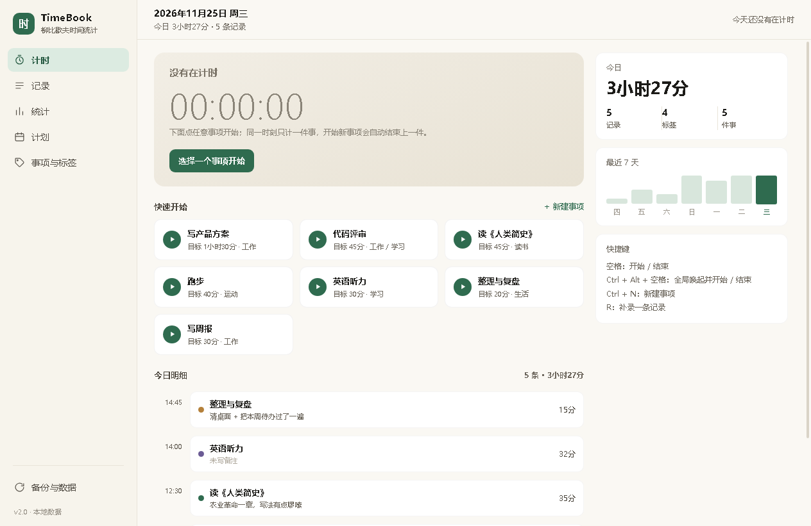
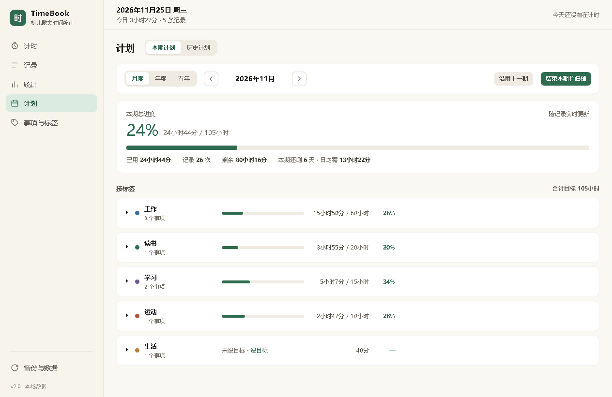
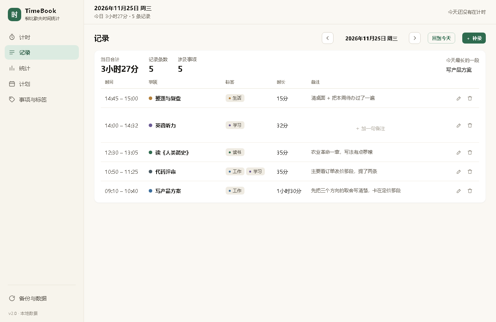
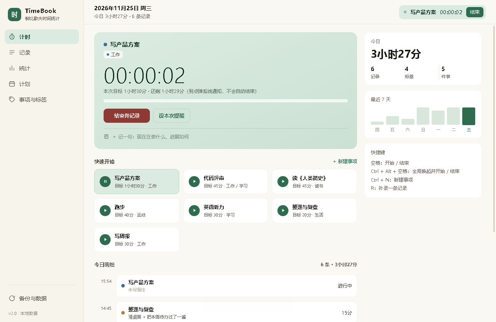

# TimeBook · 柳比歇夫时间统计

> 看清你的时间去哪了，不必交给任何云端。

一款把柳比歇夫时间统计法做成软件的本地优先工具：**不注册、不联网、无广告，数据只存在你自己的设备上**。Windows 与安卓双端可用，备份文件互通。



## 下载

| 平台 | 版本 | 大小 | 下载 |
| --- | --- | --- | --- |
| Windows | v2.1.0 | 110 MB | [从 Releases 下载 exe](https://github.com/CodeNerverEnd/TimeBook/releases) |
| Android | v1.2 | 11 MB | [下载 APK](downloads/TimeBook-1.2.apk) |

> Windows 安装包 `TimeBook-2.1.0-桌面版.exe` 有 110 MB，超过 GitHub 单文件 100 MB 上限，无法直接放进仓库，因此放在 Releases。双击 exe 即可用，免安装、不需要 .NET 或 JDK。

## 为什么做它

市面上免费的番茄钟很多，但很少有一款工具能让你**诚实地回头看**——不上传、不分析、不推送，只是安静地把每一段时间记下来。TimeBook 的全部设计都围绕两件事：

- **数据全在本地**：无账号、无云端、无广告，断网照用；换手机导一个 JSON 文件就能带走。
- **手机电脑互通**：两端备份格式完全一致（`schemaVersion 3`），互相导入零转换。

## 功能

| 模块 | 说明 |
| --- | --- |
| 计时 | 点事项卡片开始；同一时刻只计一件，开始新的会自动结束上一件。结束时可写一句备注（非必填） |
| 提醒 | 事项可设默认目标时长；到点弹系统通知，**不会自动结束**，窗口最小化或收进托盘也照常提醒 |
| 记录 | 按天翻看，可补录、改时间、改备注、删除；一条记录 = 1 次 |
| 统计 | 日 / 月 / 年；按标签汇总并可展开到具体事项；一个事项挂多个标签时各标签分别计入 |
| 计划 | 月度 / 年度 / 五年（2021 年起算）；可给标签或具体事项设目标；到期写总结后归档，历史计划保留快照 |
| 备份 | 导出 / 导入 JSON，与手机端同格式；桌面版每日自动备份保留 5 份 |
| 双端 | 手机随手记，电脑看统计，同一份备份互通 |






## 快捷键（Windows）

| 快捷键 | 作用 |
| --- | --- |
| 空格 | 开始 / 结束计时 |
| Ctrl + Alt + 空格 | 全局唤起窗口并开始 / 结束 |
| Ctrl + N | 新建事项 |
| R | 补录一条记录 |
| Esc | 关闭弹窗 |

关闭窗口只是收进托盘，程序仍在后台计时。真正退出请右键托盘图标 → 退出。

## 数据在哪

```
Windows:  %APPDATA%\TimeBook\data.json          主数据文件（原子写，保留 .bak）
          %APPDATA%\TimeBook\backups\           每日自动备份，保留最近 5 份
Android:  应用私有目录，通过「事项 → 备份与恢复」导出 JSON
```

## 和手机互通

1. 手机：事项页 → 备份与恢复 → 导出，得到 `TimeBook-备份-*.json`
2. 电脑：备份与数据 → 从文件导入，可选合并或覆盖

事项、标签、全部记录、计划目标、每期总结与归档快照都会带过去。


## 反馈与建议

遇到问题或想要新功能，直接提 GitHub Issue：

**[提交反馈](https://github.com/CodeNerverEnd/TimeBook/issues/new)**

## 源码结构

```
TimeBook/           安卓源码（Kotlin + Compose + Room）
TimeBook-Desktop/   Windows 源码（Electron + 原生 HTML/CSS/JS）
assets/             截图与收款码
downloads/          Android APK（Windows exe 见 Releases）
```

两版的统计、计划、备份口径逐条对齐，核心规则在 `TimeBook-Desktop/src/core.js` 与安卓端 `util/` 下。

## 开发

```bash
# Windows 桌面版
cd TimeBook-Desktop
npm install
npm start          # 本地运行
npm run dist       # 打包便携 exe（或双击「打包桌面版.bat」）

# 安卓版
用 Android Studio 打开 TimeBook/，assembleRelease
```

## 授权

个人免费软件，源码公开仅供学习与审计。安装包可自由分发，但请保留出处。
